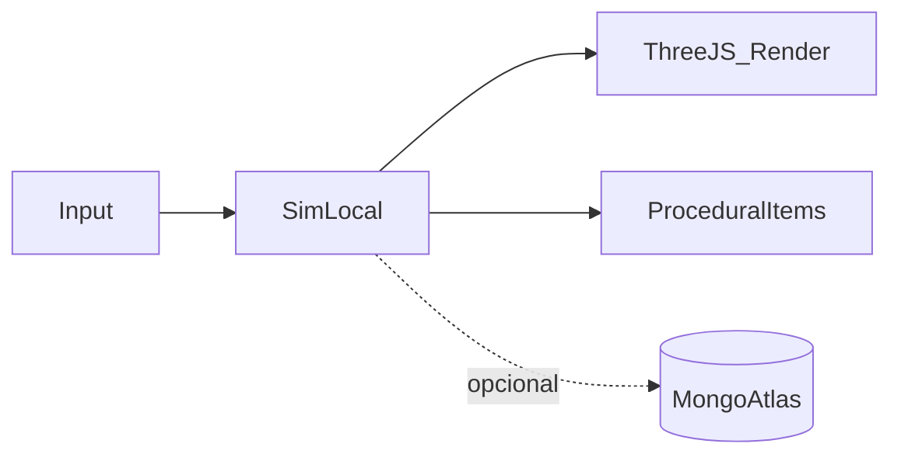
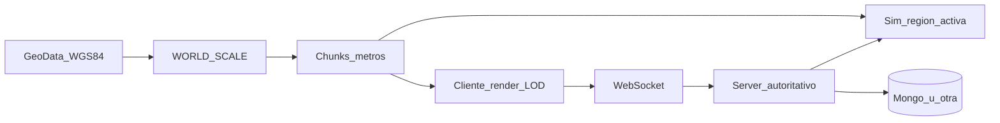

# Future Warriors — Plan (MMO planeta)

Fuente: plan Cursor `mmo_planeta_fases`. Documento maestro de arquitectura y fases.

# MMO planeta — documento maestro de arquitectura y fases

Este documento es la **fuente de verdad** del proyecto. No descartar visiones futuras al codear Fase 0: la Fase 0 debe dejar ganchos (módulos, seeds, sim desacoplada) alineados con lo de abajo, aunque no implemente multiplayer ni planeta todavía.

**Gate de producto:** implementar solo Fase 0 ahora. Tras jugarla, decidir si las fases 1+ siguen, cambian, se suspenden o se cancelan. Hasta ese review, las fases 1+ son **especificación futura**, no backlog automático de código.

---

## 1. Visión general

Estamos desarrollando un MMO (Massively Multiplayer Online) cuyo mundo estará basado en el planeta Tierra, conservando su geografía, forma y, como objetivo de diseño, dimensiones planetarias jugables (ver escala).

El objetivo es construir un **mundo virtual persistente**, compartido por una enorme cantidad de jugadores, con exploración, combate, equipamiento, inventarios, comercio, transporte y economía propia.

No queremos un RPG tradicional con “un mapa grande”. Queremos un mundo virtual global donde la geografía, las distancias, las infraestructuras y las decisiones de los jugadores tengan consecuencias reales en la experiencia.

El proyecto es ambicioso y de desarrollo prolongado. La arquitectura debe permitir crecer progresivamente **sin reconstruir** los sistemas fundamentales.

### Intención de diseño confirmada por el autor

- Mapa **realmente gigante**.
- Cantidad de ítems no acotada a una biblioteca fija: **casi infinitas combinaciones** (muchas espadas, arcos, escudos, botas, etc.).
- **Nada de ítems decorativos** por ahora: solo objetos que mejoren combate, locomoción o cosas vitales.
- Economía con **trade P2P**; evaluar más adelante si hace falta IA/NPC que venda (si el mercado no arranca solo).
- **Micrófono por proximidad**: la gente debe poder hablarse si quiere.
- **Sistema de amigos** (in-game primero; Steam friends como opción futura): agregar, borrar, mensajes privados, marcar ubicación de un amigo en el mapa si está seleccionado (y con permiso/reglas claras).
- **Sistema bancario**: deseado, diseño aún no cerrado.
- Transporte mínimo: **avión y barco**.
- Foco social a largo plazo: **fomentar PvP** más que PvE; la IA existe como filler de contenido/loot, no como eje principal del juego final.
- Escala: candidata inicial **1:4** respecto de dimensiones terrestres (tunable). 1:1 puede ser demasiado vacío/lento; 1:2–1:3 también son opciones tras playtest de densidad.

---

## 2. Escala y geografía del mundo

### 2.1 Qué incorporar (largo plazo)

- Continentes, costas, islas y océanos.
- Montañas, valles, ríos y lagos.
- Bosques y biomas distintos.
- Ciudades y localidades reconocibles.
- Carreteras, caminos e infraestructuras.
- Aeropuertos, aeródromos y puertos existentes (como nodos de transporte).
- Edificios y construcciones relevantes **sin** modelar a mano todo el planeta.

La **generación procedural** será fundamental para terrenos, estructuras secundarias, vegetación, objetos y elementos de escenario.

Se deberá investigar el uso de **datos geográficos reales** y fuentes cartográficas para construir el mundo de forma automatizada.

### 2.2 Cuatro dimensiones que NO se deben confundir

1. **Geografía física** del planeta (datos lat/lon, elevación, costas).
2. **Representación visual** de esa geografía (LOD, stylization, lo que el cliente dibuja).
3. **Distancias mecánicas** del juego (metros de gameplay tras `WORLD_SCALE`).
4. **Tiempos de desplazamiento** (walk vs avión/barco; tablas de duración comprimidas).

Una costa puede verse “realista”, medir X metros de juego a escala 1:4, y un vuelo entre dos aeropuertos durar Y minutos de reloj real vía timestamps — tres decisiones distintas.

### 2.3 Criterio de escala 1:4

- Constante de diseño: `WORLD_SCALE` (inicial `1/4`), cambiable sin rehacer el sistema de coordenadas.
- 1:1 suele producir mapas vacíos y walk-times muertos para un MMO.
- 1:4 mantiene siluetas reconocibles y densifica encuentros.
- Tras playtests de densidad PvP: si sobra vacío → comprimir más (1:6/1:8); si se siente chico → acercar a 1:2.
- Avión/barco siguen siendo necesarios aunque se comprima el mapa; sus duraciones se balancean por **tabla de rutas**, no solo por la escala.

---

## 3. Cámara y representación visual

- Preferencia fuerte: **cámara 3D isométrica** (ángulo fijo o casi fijo, perspectiva suave u ortográfica).
- Alternativa a evaluar más tarde: tercera persona / 3D tradicional.
- Criterios de evaluación: rendimiento, inmersión, exploración, combate, visibilidad, complejidad de desarrollo, representación de mundo gigantesco.
- Estética atractiva **sin** hiperrealismo. Prioridad: coherencia visual, reconocimiento geográfico, eficiencia.
- **Fase 0 usa isométrica** y no bloquea un cambio posterior si el review lo pide.

---

## 4. Rendimiento y optimización (pilares futuros)

Aspiración de diseño: decenas/cientos de miles de usuarios concurrentes **a validar con carga real**, nunca asumir.

El cliente **nunca** carga ni renderiza el mundo completo.

Contemplar a futuro:

- Streaming dinámico de terreno y escenarios.
- División geográfica en **chunks/sectores**.
- Frustum culling, occlusion culling.
- LOD y HLOD.
- Instancing para elementos repetitivos.
- Simplificación de geometría a distancia.
- Reducción de animaciones/efectos de entidades lejanas.
- Descarga/evicción de recursos fuera de uso.
- Gestión eficiente de memoria y GPU.
- Diferentes niveles de detalle según distancia y visibilidad.

Separar siempre:

- **Render del cliente** vs **simulación del servidor**.
- Que un objeto no sea visible no implica que su estado deje de existir.
- El servidor **no** debe simular individualmente todos los elementos del planeta todo el tiempo → simulación por regiones, con distintos niveles de actividad.

En Fase 0 esto se respeta solo como **separación de módulos** (`sim/` vs `render/`), sin implementar streaming planetario.

---

## 5. Sistema de transporte (core futuro)

Las distancias planetarias exigen medios de transporte. Mínimo confirmado: **aviación** y **marítimo**.

### 5.1 Aviación

- Aeropuertos / aeroparques / aeródromos operativos = nodos.
- Rutas, horarios de salida, frecuencias, capacidad, costos, duración, categorías de aeronaves.
- El jugador llega **físicamente** al aeropuerto y adquiere pasaje.
- Al iniciar el viaje: pierde control temporal del personaje.
- UI: planisferio, ruta, ubicación del avión, tiempo restante.
- Al llegar: aparece en aeropuerto destino y recupera control.
- El viaje **continúa si cierra el cliente**; el servidor administra salida/llegada/duración con **timestamps**.
- Tiempos comprimidos vs real, pero con diferencia clara entre trayectos cortos, nacionales e intercontinentales.

### 5.2 Transporte marítimo

- Puertos existentes = nodos.
- Rutas, horarios, frecuencias, tipos de embarcación.
- Capacidad tipicamente mayor; costos potencialmente menores; viajes más largos.
- Conexión a islas/localidades sin aeropuerto.
- Los barcos deben ser **alternativa real**, no “avión malo”.
- Futuro: carga/mercancías con relevancia económica.

### 5.3 Arquitectura común de transporte

- Aéreo y marítimo comparten modelo `Trip` cuando convenga: origen, destino, `departAt`, `arriveAt`, vehículo, asientos/capacidad, costo, estado.
- Un viaje es **entidad persistente de servidor**, no animación atada al cliente abierto.
- No hace falta simular física completa del vehículo durante el traslado.

**No implementar en Fase 0.** Dejar tipos/interfaces en `shared/` solo si no ensucia; si no, documentar aquí y crear en Fase 2.

---

## 6. Equipamiento e ítems procedurales (core)

Pilar central: no depender de una biblioteca limitada de modelos predefinidos.

Familias objetivo (casi infinitas variantes):

- Espadas, hachas, arcos, ballestas, escudos.
- Armaduras, cascos, botas, guantes.
- Anillos, amuletos (solo si aportan stats vitales/combate/locomoción).
- Pociones / consumibles vitales.
- Materiales y herramientas **si** sirven al loop (crafting útil); si no, posponer.
- **Prohibido por ahora:** ítems solo decorativos / cosméticos sin efecto.

Cada objeto puede tener identidad visual y funcional propia.

El sistema debe combinar:

- Geometría procedural y/o piezas modulares.
- Materiales y texturas.
- Tamaños y proporciones.
- Estadísticas, rarezas, atributos especiales.
- Calidad de fabricación, desgaste (cuando se diseñe).
- Identidad y procedencia (cuando aplique).

**Regla crítica:** las variaciones no son solo color/stats. Las características físicas deben influir en el gameplay.

Ejemplo: espada larga/pesada ≠ espada corta/liviana (reach, speed, damage, recovery).

Generación **determinista** por **seed + parámetros persistidos**. No guardar geometría duplicada en DB: se regenera la malla en cliente (o en tool) desde seed/params.

Control de generación de loot/económico: a futuro **servidor autoritativo**. En Fase 0, la sim local emite loot; el código de generación vive en módulo reutilizable (`items/` / `shared/`).

---

## 7. Inventario, economía, banca, amigos, voz

### 7.1 Inventario y economía

Los jugadores podrán (visión):

- Obtener, equipar (si cumplen requisitos), guardar en inventarios/mochilas/baúles.
- Transportar, vender, comprar a otros jugadores, intercambiar.
- Fabricar si hay crafting (no Fase 0).

Objetos con **identidad individual** cuando corresponda (instancia + seed/params).

Economía con seguridad de servidor: anti-dupe, transacciones atómicas, persistencia de inventarios.

Trade **P2P** confirmado. NPC vendors: solo si el playtest económico lo justifica.

### 7.2 Banca (TBD de diseño, no olvidar)

Deseada. Decisiones abiertas a documentar cuando se cierre:

- ¿Depósito seguro anti-robo / anti-loss-on-death?
- ¿Límites de slots / tasas?
- ¿Ubicaciones físicas (sucursales) vs acceso global?
- Relación con baúles personales y riesgo PvP.

No codear hasta tener reglas claras post–Fase 0 / economía básica.

### 7.3 Amigos

In-game primero:

- Agregar / borrar.
- Mensajes privados.
- Marcar ubicación de un amigo seleccionado en el mapa (respetar privacidad/opt-in).

Futuro: integrar amigos de Steam si hay distribución Steam.

### 7.4 Voz por proximidad

Requisito confirmado a medio plazo: chat de voz espacial/por radio de proximidad (WebRTC / LiveKit o similar). No Fase 0.

---

## 8. Arquitectura técnica

### 8.1 Restricción de infraestructura ACTUAL (obligatoria)

- **No hay servidores de juego en la nube** disponibles ahora.
- Todo desarrollo y playtest corre en la máquina del autor (`localhost`).
- Pieza remota aceptada: **MongoDB Atlas** (cluster gratuito) para persistencia opcional.
- No asumir Postgres, Redis cloud, ni game hosts pagos en el corto plazo.
- Cuando exista multiplayer, el primer paso será **servidor Node en localhost**, no cloud.

### 8.2 Stack elegido para empezar (Fase 0) y proyección

| Capa | Fase 0 (ahora) | Proyección post-gate |
|---|---|---|
| Cliente 3D | Vite + Three.js + TypeScript | Mismo, salvo review que diga lo contrario |
| Cámara | Isométrica 3D | Reevaluar vs 3D tradicional |
| Simulación | Módulo `sim/` **en el mismo proceso del cliente** | Extraer a Node autoritativo + WebSocket |
| Persistencia | Memoria + opcional Mongo Atlas | Mongo (o reevaluar) para cuentas/inventarios/viajes |
| Networking | Ninguno | WS autoritativo; regiones; shards cuando haya carga |
| Mundo | Mini mapa plano local | Chunks + geo data + `WORLD_SCALE` |

Principios permanentes:

- Servidor (cuando exista) **autoritativo** sobre: posición válida, stats, loot, inventarios, combate, economía.
- Cliente no decide unilateralmente esos estados.
- Arquitectura modular y testeable; **no** microservicios el día 1.
- Separar lógica de negocio, representación visual y persistencia.
- Medir rendimiento; no asumirlo.
- Evitar deuda estructural y dependencias innecesarias.

### 8.3 Diagrama actual (Fase 0)

### 8.4 Diagrama objetivo (post multiplayer)

---

## 9. Filosofía de desarrollo

- Desarrollo progresivo acelerado con IA, sin decisiones que rompan la arquitectura.
- No implementar features sin entender impacto arquitectónico.
- No sobredimensionar infraestructura prematuramente.
- Priorizar sistemas reutilizables.
- Documentar decisiones importantes (este archivo + `docs/ARCHITECTURE.md` al ejecutar).
- Diseñar para escalar en los **fundamentos** (chunks, autoridad, seeds), no en la factura cloud del día 1.
- La tecnología sirve al juego: **validar diversión temprano**.

Instrucciones operativas para el agente al codear:

- No interpretar el proyecto como “RPG chico al que después le pegamos multiplayer” sin dejar ganchos; tampoco construir la infra de 100k CCU en el commit 1.
- Si una idea es inviable/cara, proponer alternativa **sin** tirar la intención original.
- Ante duda entre “completo futuro” y “simple jugable”, priorizar jugable **sin borrar** este documento.

---

## 10. Riesgos principales

1. **Vacío social** en mapa enorme → hotspots (ciudades/aeropuertos), densidad de jugadores, matchmaking blando a zonas activas.
2. **Ítems procedurales feos o rotos** → restricciones por rareza, whitelists de combos, seeds curadas.
3. **Dupes / economía rota** → autoridad servidor + transacciones atómicas desde el primer inventario online.
4. **Sobreingeniería CCU** → localhost → un proceso regional → medir → shard.
5. **Demo técnica sin diversión** → Fase 0 existe para evitarlo (combate, move, loot).
6. **Confundir geo/visual/metros/tiempos** → romper transporte y sensación de mundo.
7. **Olvidar el core PvP** por llenar de PvE → IA solo filler; no diseñar el endgame alrededor de farmeo PvE.

---

## 11. Roadmap por fases

### Fase 0 — Prototipo local jugable (ÚNICA a implementar ahora)

**Objetivo:** probar combate, locomoción y loot. Un jugador. Sin red de juego.

**Alcance:**

- Mini mapa (orden decenas/centenas de metros), terreno simple.
- 1 jugador controlable.
- Movimiento (WASD) + cámara isométrica que sigue al jugador.
- Varias IA (ej. 3–8): chase + attack simples.
- Combate melee básico: cooldown, hitbox/reach según arma equipada.
- Al morir, la IA dropea loot (al menos espadas procedurales).
- Generador de espadas: `seed` → mesh + params (`bladeLength`, `weight`, etc.) → stats (`damage`, `reach`, `attackSpeed`) que **se sientan distintos**.
- Inventario mínimo + equipar arma.
- HUD: HP jugador, arma equipada, slots básicos.
- Persistencia opcional a Mongo Atlas (inventario/seeds); si no hay red, el juego sigue en memoria.
- Código organizado: `sim/` (estado, combate, IA, inventario) separado de `render/` (Three.js).

**Fuera de Fase 0:**

- PvP, WebSocket, cuentas reales, chunks planetarios, geo Earth, aviones/barcos, voz, amigos, trade P2P, banca, microservicios, cloud game server.

**Criterio de éxito:**

- Se siente bien moverse.
- Pelear contra IA es legible.
- Dos espadas distintas cambian el feel (alcance/velocidad/daño).
- Loot se recoge y se equipa al instante.

**Después de Fase 0:** review-gate explícito (todo `review-gate`) antes de tocar Fase 1+.

---

### Anotación post–Fase 0 (Cursor notebook — no es el autor del plan)

> **Origen de esta nota:** la escribió **Cursor en la notebook** del autor (sesión de playtest / iteración local), **no** el Cursor de escritorio que redactó este plan maestro (`mmo_planeta_fases` / documento original).
>
> **Contexto (2026-11-18):** Fase 0 ya está implementada y el gametest inicial se considera aceptable. El autor **no cuenta aún con servidores ni capacidad de hostear** algo online; la parte de red de Fase 1 queda **muy adelante**.
>
> **Desglose práctico de Fase 1** (sin borrar la spec original de abajo):
>
> - **Fase 1a — offline / solo cliente:** engordar el prototipo local sin red: chunks/streaming en cliente, más familias de ítems con efecto gameplay, combate/feel, reglas de corpse/loot orientadas a PvP (aunque el PvP online llegue después). No requiere hostear nada.
> - **Fase 1b — online local / autoritativo:** servidor Node + WS en localhost, 2+ clientes, persistencia Atlas, trade P2P, `sim/` en server. Puede hacerse en una sola máquina **sin** VPS; lo que sí queda bloqueado hoy es lo **siempre-on** (mundo compartido remoto, CCU, planeta persistente 24/7).
>
> Hasta nuevo review, priorizar **1a**. **1b** y fases 2+ siguen siendo especificación futura, no backlog automático.

---

### Fase 1 — Mundo en chunks, más ítems, base online local (PROVISIONAL)

Especificación futura (no codear hasta gate). Ver desglose **1a / 1b** en la anotación de Cursor notebook arriba.

- Introducir división en chunks y streaming básico de una región mayor.
- Más familias de ítems útiles: arcos, escudos, botas (move-speed), etc., siempre con efecto gameplay.
- Reglas de corpse/loot orientadas a PvP (aunque el PvP llegue en sub-paso).
- Primer servidor autoritativo en **localhost** (Node + WS): 2+ clientes locales.
- Persistencia sólida en Mongo Atlas: cuenta, personaje, instancias de ítem (seed+params).
- Trade P2P cercano (ventana de intercambio atómica) cuando haya 2 jugadores.
- Mantener `sim/` como fuente de verdad movida al server.

Criterio tentativo: dos clientes en la misma máquina pelean/lootean sin dupes.

---

### Fase 2 — Transporte avión y barco (PROVISIONAL)

- Modelo persistente `Trip` (origen, destino, `departAt`, `arriveAt`, tipo vehículo, costo, estado).
- Nodos stub: al menos un aeropuerto y un puerto en el contenido disponible.
- Flujo: llegar al nodo → comprar pasaje → perder control → UI planisferio → spawn en destino.
- Viaje avanza con timestamps aunque el cliente esté cerrado (requiere server persistente local o siempre-on futuro).
- Arquitectura compartida aire/mar.
- Balance de duraciones comprimidas con diferencias cortas/medias/largas.
- Marítimo como alternativa real (más lento, más barato/capaz).

No física completa del vehículo en tránsito.

---

### Fase 3 — Social: amigos y voz (PROVISIONAL)

- Amigos in-game: add/remove, DM, pin de ubicación en mapa con reglas de privacidad.
- Voz por proximidad (radio fijo; WebRTC o LiveKit).
- Integración Steam friends solo si hay build Steam.
- No acoplar la voz al combate de forma que rompa el netcode; canal separado.

---

### Fase 4 — Planeta, densidad, economía extendida (PROVISIONAL)

- Ingesta de datos geo (costas, elevación) proyectados con `WORLD_SCALE`.
- Más regiones; hotspots de encuentro; tuning de escala.
- Procedural de vegetación/estructuras secundarias.
- NPC vendors solo si P2P no liquida el mercado.
- Diseñar e implementar **banca** cuando las reglas estén cerradas.
- Asegurar que distancias mecánicas y tiempos de viaje sigan la sección 2.2.

---

### Fase 5 — Escala de jugadores y hardening (PROVISIONAL)

- Métricas reales de CCU, CPU, bandwidth.
- Sleep de regiones inactivas; handoff entre procesos/shards.
- LOD/HLOD, instancing, culling agresivo, evicción de assets.
- Load tests honestos; no claim de “100k” sin evidencia.
- Seguridad: validación anti-cheat básica, rate limits, auditoría de economía.

---

## 12. Qué se escribe en el repo al ejecutar (aprobación del usuario)

1. `docs/ARCHITECTURE.md` — copia fiel/condensada de **este** documento (sin borrar fases futuras).
2. App local: estructura tipo `client/` (render+boot), `sim/` (juego), `shared/` (tipos de ítems/seeds), opcional helper de Mongo.
3. **Solo código de Fase 0.**
4. README mínimo: cómo `npm install` / `npm run dev` y variables si se usa Atlas.

## 13. Fuera de alcance hasta pedido explícito post-gate

Banca detallada, Steam, microservicios, editor visual de armas, crafting completo, modelado manual masivo del planeta, Meshy/Blender como pipeline principal, voz, PvP online.
